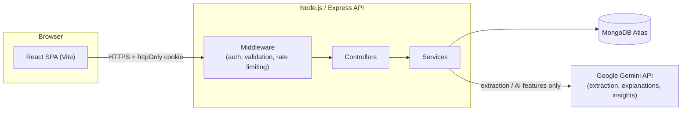
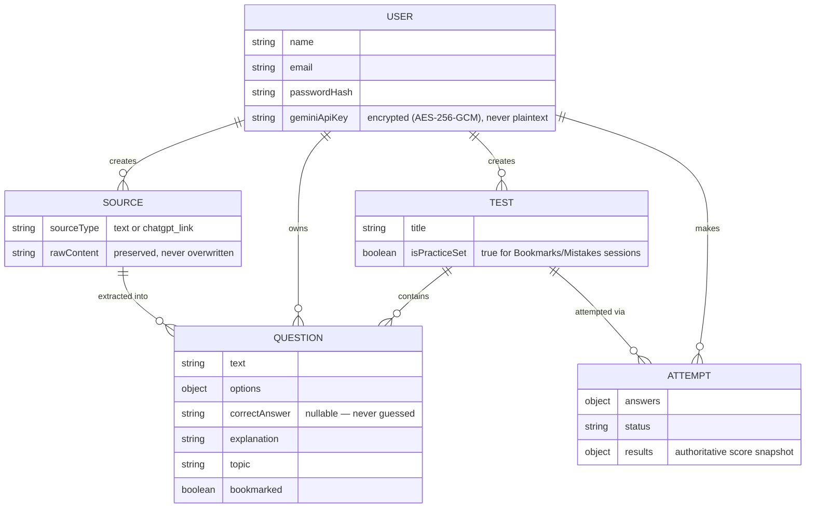
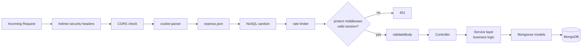
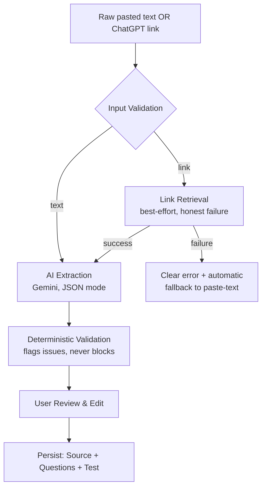
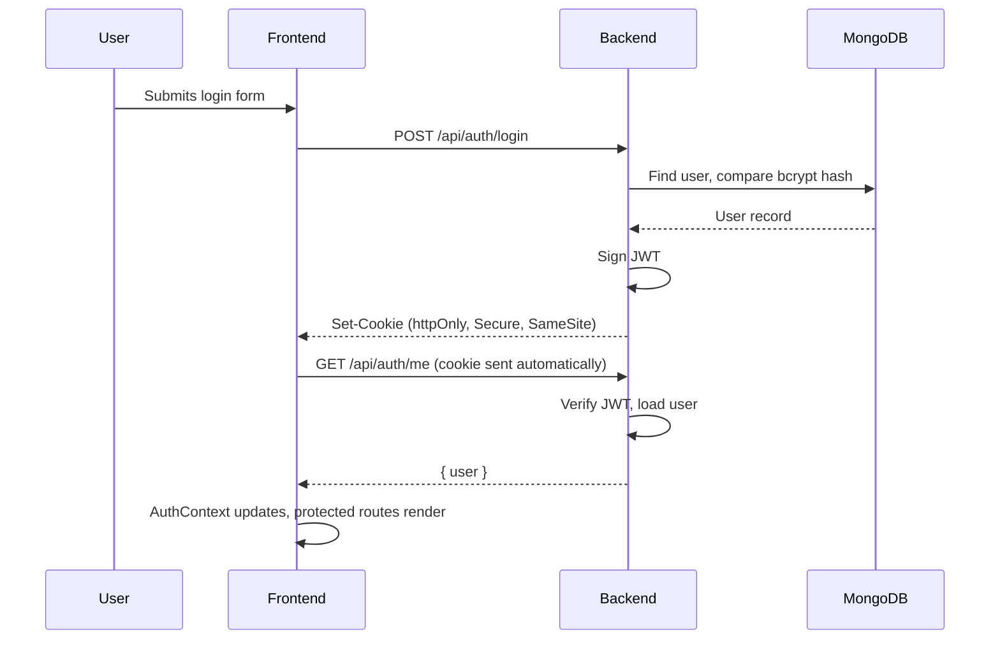
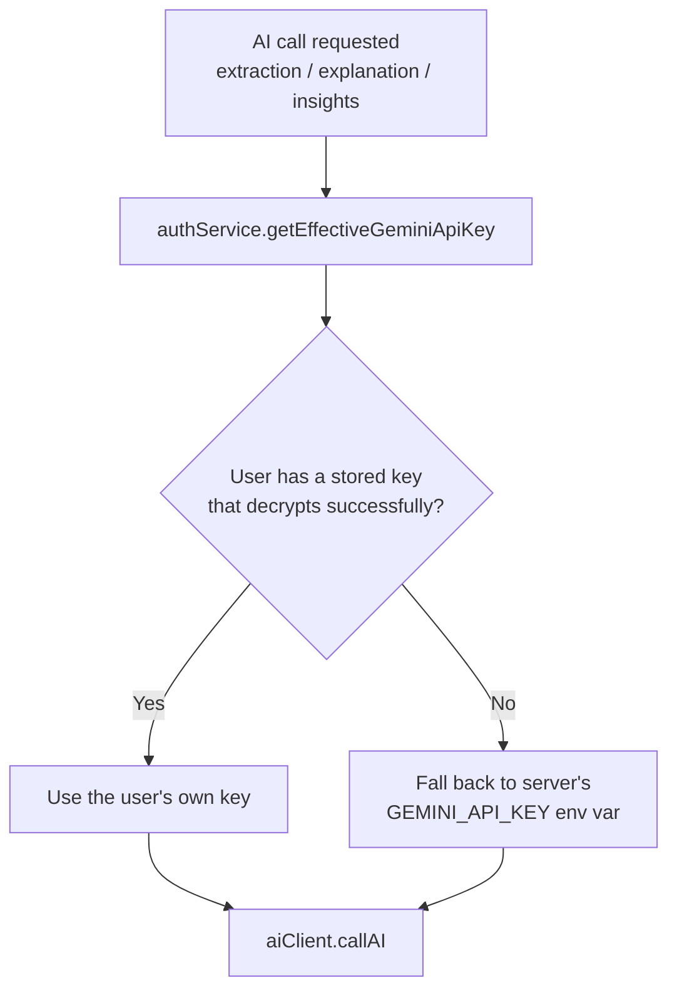

# Architecture

Technical documentation of how Exam Practice Challenges is actually built
— system structure, data model, key flows, and the reasoning behind the
decisions that mattered most. All diagrams are Mermaid, which GitHub
renders natively in markdown.

## System Overview

The frontend never talks to Gemini directly — every AI call is proxied
through the backend, which is what makes it possible to rate-limit AI
usage, keep the API key server-side only, and keep AI strictly out of any
calculation the app can do deterministically (see "AI's Boundary" below).

## Data Model

A few relationships worth calling out explicitly:

- **Source → Question** is preserved even after extraction — the original
  pasted text or retrieved link content is never discarded, so extraction
  could theoretically be re-run later without asking the user to paste again.
- **Test → Question** is the real source of truth for what's in a test —
  `Question.test` is more of a convenience back-reference. This distinction
  matters for practice sessions (see "Key Design Decisions" below).
- **Attempt.results** is a *snapshot*, computed once at submit time and
  never recalculated — editing a Test's questions later must never
  silently rewrite the score of an attempt someone already took.

## Request Flow

Controllers stay deliberately thin — parse the request, call a service,
shape the response. All business logic lives in the service layer, which
never knows or cares whether it was called from an HTTP request; this is
what let later milestones (like the practice-session builder) reuse
existing service functions without touching a single controller.

## Extraction Pipeline

There's no official API for reading a shared ChatGPT conversation — the
share page is client-rendered, so link retrieval is genuinely best-effort.
What's guaranteed is the *failure path*: a specific, honest reason
reported back, with automatic fallback to pasting text, rather than a
silent empty result.

## Authentication Flow

The session token lives in an httpOnly cookie, not `localStorage` —
invisible to JavaScript entirely, which is what stops an XSS
vulnerability elsewhere in the app from being able to steal it. The
tradeoff: the frontend can never just "check" if someone's logged in —
it asks the backend, every time, via `GET /api/auth/me`.

## AI's Boundary — the rule enforced throughout

Every AI-touching feature in this app follows one rule without exception:
**AI can write prose about facts; it can never calculate the facts
themselves.**

- Extraction produces structured data (text, options, a possible answer)
  — but the score for an attempt is *always* recomputed server-side from
  the real stored `correctAnswer` values, never trusted from the client
  or from anything AI said.
- AI Insights (`insightsService.js`) is handed a finished, already-computed
  set of statistics and explicitly instructed never to invent an
  additional one — the model writes 2-3 sentences *about* numbers that
  already exist, nothing more.
- Every AI call is user-triggered (a button click), never automatic —
  cost-consciousness by design, not by accident.

## Per-User AI Key Resolution

Every account provides its own Gemini API key at registration
(mandatory, encrypted at rest). Every AI-calling code path resolves
which key to actually use through one shared function, rather than
each service deciding independently:

The fallback path exists for two real cases, not as a loophole around
"mandatory": accounts created before this feature existed never had a
key collected, and it protects against a stored key that's somehow
corrupted or fails to decrypt. Every account created going forward
always has its own key, so the fallback is a safety net, not the
normal path.

A wrong or revoked key produces a specific, actionable error
("Your Gemini API key appears to be invalid...") rather than a raw
API error dump — worth surfacing clearly since it's now something an
individual user's own input can cause, not just a server
misconfiguration.

## Key Design Decisions

A compiled list of the choices that mattered most, in the order they came up:

| Decision | Why |
|---|---|
| Scoring computed twice (client + server) | Client gives instant feedback; server is the only one ever trusted for the stored, authoritative record — a client could otherwise submit a fabricated score |
| `correctAnswer` stripped from the API during an active test | Without this, the answer key would sit in the browser's Network tab for the whole exam |
| Practice sessions (Bookmarks/Mistakes) never reassign question ownership | Building a practice set from questions across several existing tests must never silently steal them away from where they actually belong |
| "Mistakes" reflects only the most recent attempt per test | Showing permanent history would keep flagging things you've since mastered — always reflects where things stand right now |
| httpOnly cookie over `localStorage` token | Session token is invisible to JavaScript, closing an entire class of XSS token-theft |
| `SameSite=None` only in production | Cross-origin deployment (frontend/backend on different domains) requires it; same-origin local dev doesn't, and forcing it there would break nothing but is unnecessary |
| "Weak areas" deferred until real topic data existed | Building an analytics feature on permanently-empty data would be worse than not building it — shipped once extraction actually tagged topics, not before |
| Route-based code splitting | Eleven pages' worth of JS was shipping to every visitor regardless of which page they needed |
| Gemini API keys encrypted (AES-256-GCM), not plaintext | A leaked database dump shouldn't hand over usable API keys — encryption means the separate server-side encryption key is also required |
| Password changes require the current password, even mid-session | Without this, a hijacked or unattended session could let an attacker silently lock out the real account owner |
| Account deletion requires typing "DELETE" to confirm | Stronger than the single-item delete confirmation used elsewhere — this action is irreversible and destroys everything, not one record |
| Progress analytics grouped by UTC calendar boundaries, not server-local time | Local-timezone date math would make grouping depend on whichever timezone the Node process happens to run in, which can silently differ between dev and a deployed host |
| My Tests shows the full list; Dashboard caps at 6 | Two different jobs — Dashboard is an at-a-glance summary, My Tests is the actual searchable library. Both reuse the same underlying service functions |

## Directory Structure

See the [README](./README.md#project-structure) for the annotated folder tree.
