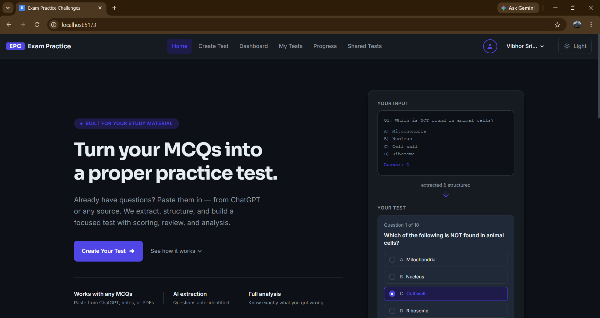
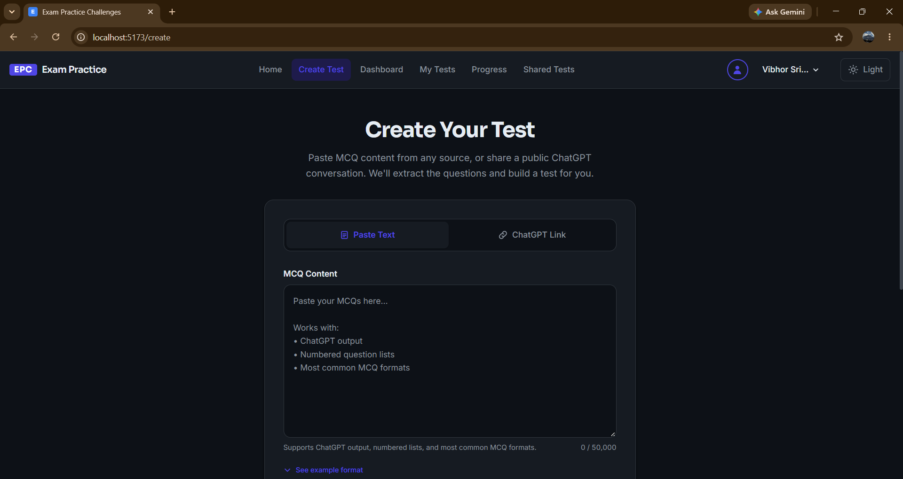
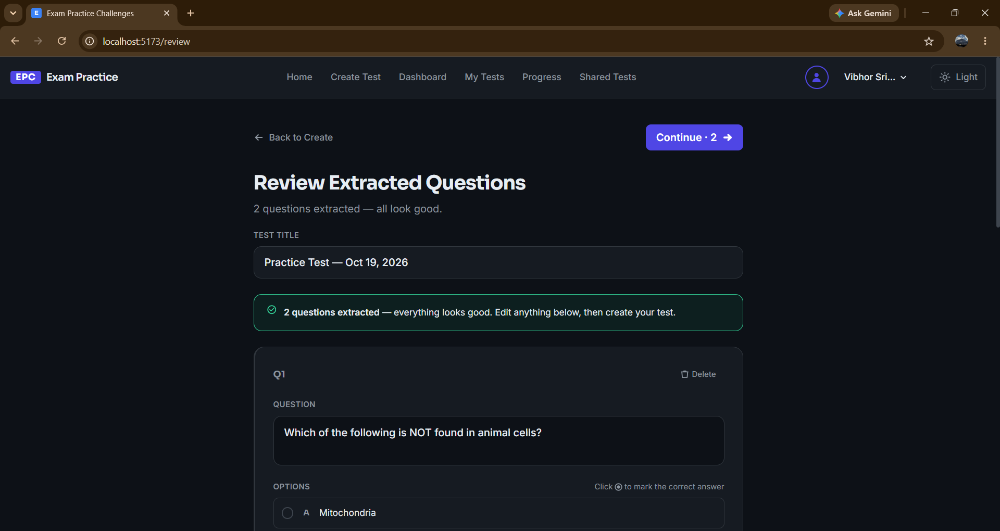
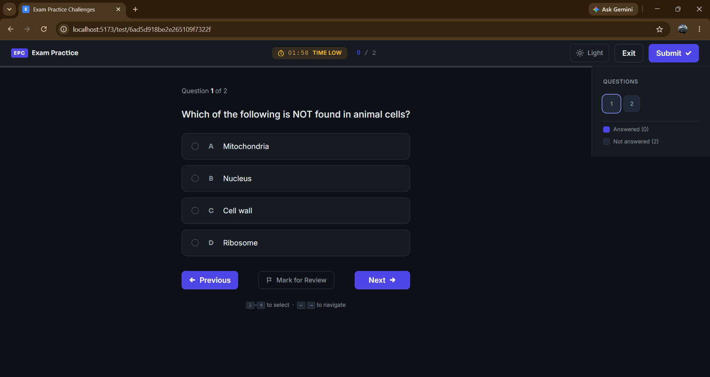
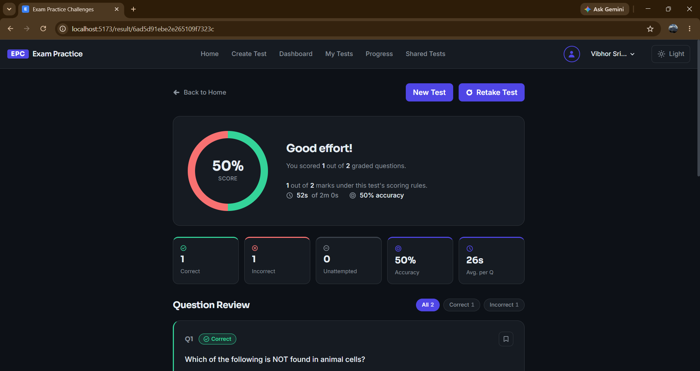
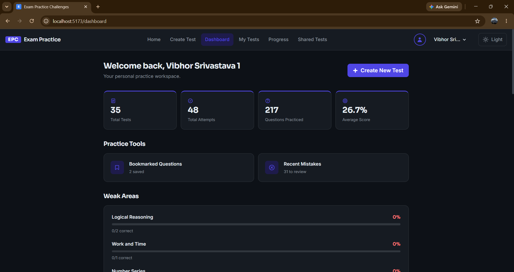
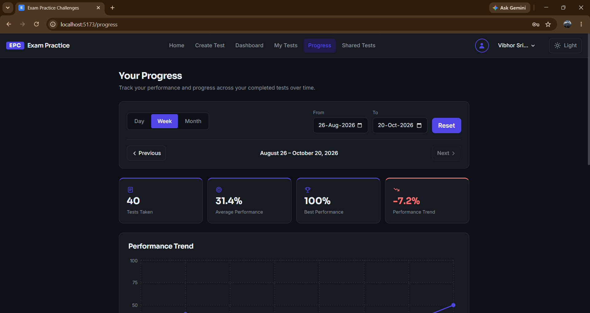
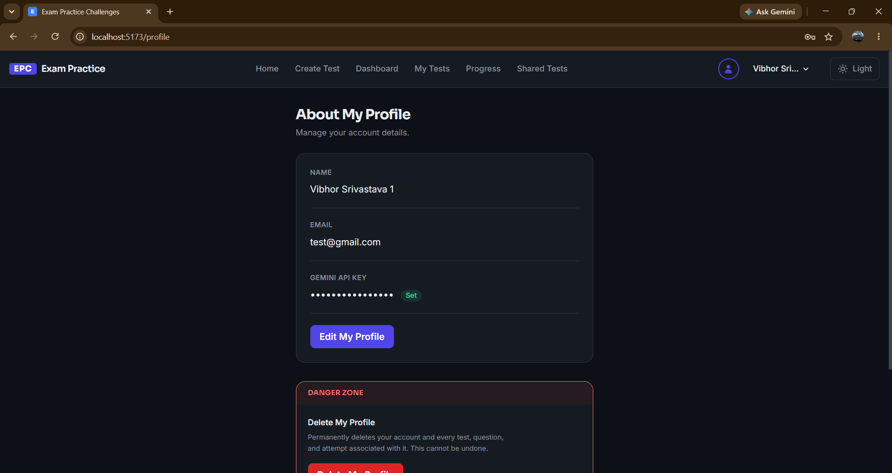

# Exam Practice Challenges

> Bring the MCQs you already have. We'll turn them into a proper practice test.

A full-stack MERN application that turns unstructured MCQ content — pasted
text, ChatGPT conversations, study notes — into structured, gradable
practice tests with AI-assisted extraction, deterministic server-side
scoring, and personalized practice tools.

**[Live Demo](#)** &nbsp;·&nbsp; **[Architecture Docs](./ARCHITECTURE.md)** &nbsp;·&nbsp; **[Deployment Guide](./DEPLOYMENT.md)**&nbsp;·&nbsp; **[Changelog](./CHANGELOG.md)**

*(Replace the Live Demo link above once deployed — see [DEPLOYMENT.md](./DEPLOYMENT.md))*

---

## What is this?

Most practice-test tools start from a pre-built question bank you browse
through. This one inverts that: **your own content is the starting point.**
Paste MCQs you already have — from a ChatGPT session, your notes, anywhere
— and the app extracts, structures, and turns them into a real test with
a timer, a question navigator, scoring, and detailed post-test analysis.

Built incrementally across 20 defined milestones, from a static landing
page through a fully authenticated, AI-integrated, deployed application.

## Features

**Test creation**
- Paste raw MCQ text, or share a public ChatGPT conversation link
- AI-powered extraction (Google Gemini) with automatic topic tagging
- Deterministic validation flags extraction issues without ever blocking you
- Full review-and-edit screen before anything is saved

**Taking a test**
- Configurable countdown timer with automatic submission when time runs out
- Question navigator (answered / marked-for-review / current, at a glance)
- Keyboard shortcuts (1-4 to answer, arrow keys to navigate)
- Correct answers are never sent to the browser while a test is in progress

**Results & analytics**
- Deterministic, server-authoritative scoring — the score shown is never
  just trusted from the client
- Filterable per-question review (correct / incorrect / unattempted / marked)
- A real, database-backed result page, addressable by URL, that survives a refresh
- Dashboard with performance trends and topic-level "weak areas" — computed
  from real data, never fabricated

**Personalized practice**
- Bookmark any question while reviewing a result
- "Mistakes" — questions you got wrong on your most recent attempt of each
  test (not permanent history — get it right on a retake and it clears)
- Build an ad-hoc practice session from either set, reusing the full
  test-taking engine

**Personal workspace & account**
- A complete, searchable list of every test you've created (My Tests),
  separate from the Dashboard's recent-activity view
- Visual Progress Analytics — day/week/week/month grouping, calendar date
  range selection, and interactive trend/comparison charts, computed
  entirely from real attempt data (never AI-generated)
- Full profile management: view and edit your name and password, with
  current-password verification required for any password change
- Full account deletion — cascades through every piece of your data
  (tests, questions, attempts, sources), with a typed confirmation step
  before it's even possible to trigger

 **AI enhancements (optional, cost-conscious)**
- Every account brings its own Gemini API key (required at signup,
  encrypted at rest — never stored in plain text) — AI usage draws from
  each user's own quota, not a single shared one
- On-demand AI-generated explanations for questions that don't have one
- AI-written performance insights — narrated from numbers the app already
  computed deterministically, never invented by the model
- Every AI call is a deliberate user action; nothing runs automatically
- A built-in guide walks new users through getting a free Gemini API key
  in about a minute


**Account & security**
- httpOnly JWT cookies (not localStorage) — session tokens are invisible to JavaScript
- bcrypt password hashing, rate-limited login/register
- NoSQL injection sanitization, security headers (helmet), CORS locked to a known origin
- Full light/dark theme support, keyboard accessibility, reduced-motion support

## Tech Stack

| Layer | Technology |
|---|---|
| Frontend | React + Vite, React Router |
| Backend | Node.js + Express |
| Database | MongoDB + Mongoose |
| Authentication | JWT in httpOnly cookies, bcrypt |
| AI | Google Gemini API (free tier) |
| Hosting | Vercel (frontend) + Render (backend) + MongoDB Atlas (database) — see [DEPLOYMENT.md](./DEPLOYMENT.md) |
| Testing | Node's built-in test runner (`node:test`) |
| Charting | Recharts |

## Screenshots

*(See [SCREENSHOTS-GUIDE.md](./SCREENSHOTS-GUIDE.md) for exactly which
states to capture — placeholders below, ready to fill in.)*

| | |
|---|---|
|  |  |
|  |  |
|  |  |
|  |  |

## Getting Started (Local Development)

### Prerequisites
- Node.js 18+
- A MongoDB connection (local `mongod`, or a free [MongoDB Atlas](https://www.mongodb.com/cloud/atlas/register) cluster)
- A free [Google Gemini API key](https://aistudio.google.com/app/apikey)

### Setup

```bash
# Clone the repo
git clone <your-repo-url>
cd exam-practice-challenges

# Backend
cd backend
npm install
cp .env.example .env    # then fill in the real values — see below
npm run dev

# Frontend (in a separate terminal)
cd frontend
npm install
npm run dev
```

The frontend runs at `http://localhost:5173`, proxying `/api` requests to
the backend at `http://localhost:5000` (configured in `vite.config.js`).

### Environment Variables

See `.env.example` in both `backend/` and `frontend/` for the complete,
current list with explanations. In short:

**Backend** — `MONGODB_URI`, `JWT_SECRET`, `ENCRYPTION_KEY` (encrypts
stored per-user Gemini API keys), `GEMINI_API_KEY` (fallback default,
used when a user's own key is unavailable), `AI_MODEL` (optional),
`CLIENT_URL`, `NODE_ENV`

**Frontend** — `VITE_API_URL` (only needed for production builds; local
dev falls back to the Vite proxy automatically)

## Testing

```bash
cd backend
npm test
```

Runs the automated suite (Node's built-in test runner — no extra
dependency) covering the app's most important deterministic logic:
scoring, extraction validation, and request validation. See
[the backend/tests folder](./backend/tests/) for what's covered and why
those specific modules were prioritized.

## Deployment

Full step-by-step guide, verified against a genuinely free hosting stack
(MongoDB Atlas + Render + Vercel): **[DEPLOYMENT.md](./DEPLOYMENT.md)**

## Architecture

System diagrams, data model, the extraction pipeline, the auth flow, and
a compiled list of the key engineering decisions made throughout this
build and why: **[ARCHITECTURE.md](./ARCHITECTURE.md)**

## Project Structure

```
exam-practice-challenges/
├── backend/
│   ├── config/          # Database connection
│   ├── controllers/      # Thin request handlers
│   ├── services/         # Business logic (the real work happens here)
│   ├── models/            # Mongoose schemas
│   ├── middleware/        # Auth, validation, rate limiting, sanitization
│   ├── routes/             # Express route definitions
│   ├── tests/               # Automated tests (node:test)
│   └── server.js
└── frontend/
    └── src/
        ├── pages/           # One folder per route, each owning its own CSS
        │                    #   (Home, Dashboard, MyTests, Profile, Progress,
        │                    #    GetGeminiApiKeyGuide, CreateTest, Review, Test,
        │                    #    Result, Bookmarks, Mistakes, Login, Register)
        ├── components/      # Shared components (Navbar, Footer, ProtectedRoute,
        │                    #   UserMenu, ScreenshotPlaceholder, PageLoadingFallback)
        │                    #   plus page-specific sub-components under
        │                    #   components/Progress/ (charts, controls, summary cards)
        ├── services/        # API client layer — one file per backend resource
        ├── context/          # Auth and Theme React contexts
        └── hooks/             # Reusable hooks (e.g. useFocusTrap)
```

## Known Limitations / Honest Notes

- ChatGPT link extraction is best-effort — there's no public API for
  reading a shared conversation, so it gracefully falls back to asking
  for pasted text when it can't retrieve content. See `linkRetrievalService.js`.
- `Test.settings` (randomized order, negative marking) exists in the data
  model but isn't yet exposed in the UI — a natural next feature.
- Render's free tier cold-starts after 15 minutes idle; see
  [DEPLOYMENT.md](./DEPLOYMENT.md) for a free workaround.
- Progress Analytics groups data by UTC calendar day/week/month, not the
  viewer's own local timezone — a test completed very late at night could
  theoretically land in what feels like the "wrong" day by a few hours.
  Chosen deliberately for server-timezone independence; see
  `backend/utils/dateGrouping.js`.
- Changing your password does not invalidate other already-logged-in
  sessions/devices — there's no server-side session store or token
  versioning to revoke, only stateless JWTs. Acceptable at this app's
  scale; worth knowing about.


## License

MIT — see [LICENSE](./LICENSE).

## Acknowledgments

- AI extraction and enhancements powered by [Google Gemini](https://ai.google.dev) (free tier)
- Built as an incremental, milestone-driven solo project
